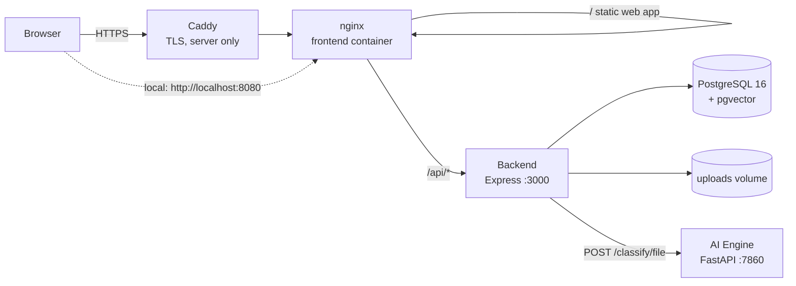
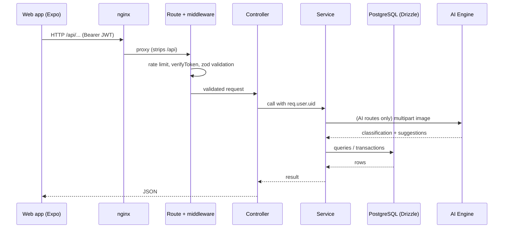

# WearWise System Architecture (ARCHITECTURE.md)

This document describes the WearWise modules, how they communicate, where data lives, and how the system is deployed.

## System Topology



- **Single origin.** The browser only talks to nginx. `/api/*` is proxied to the backend, so there is no CORS setup and no separate API domain. The web build uses `EXPO_PUBLIC_API_URL=/api`.
- **Private services.** The backend, database and AI engine have no published ports; they are reachable only on the internal Docker network.
- **Stateless containers.** All state lives in two volumes: `pgdata` (database) and `uploads` (images). Every container can be rebuilt or replaced without data loss.

### Request lifecycle


## Module Contracts

### Frontend ↔ Backend
- REST + JSON over `/api`. Errors are `{ "status": "error", "message": "..." }` with a meaningful HTTP status.
- **Auth**: `POST /auth/register`, `POST /auth/login` (`identifier` = email or phone) and `GET /auth/me`. They return a JWT (HS256, 7 days) that the client stores in AsyncStorage (localStorage on web) and sends as `Authorization: Bearer <token>`. Logout only discards the token on the client.
- **Identity**: the backend always takes the acting user from the token (`req.user.uid`), never from the request body.
- **Images**: the client uploads each image to `POST /uploads` (multipart field `image`, max 5 MB, JPEG/PNG/WebP, type checked from the file bytes) and receives an absolute URL. Listings then reference those URLs.

### Backend ↔ AI Engine
- Synchronous REST on the internal network: `POST http://ai-engine:7860/classify/file` (multipart `file`) with a 30 s timeout. No auth, because the engine is not reachable from outside.
- The backend exposes it as `POST /ai/analyze`, which requires login, is rate-limited, has a 5 MB limit and checks the image type. Engine 400/413 responses are passed through; anything else becomes 503.
- The engine's `/health` reports `ready: true` only once both models are loaded. Compose starts the backend only after that.

### Backend ↔ Database
- Drizzle ORM over `postgres.js`. Migrations live in `backend/drizzle/migrations` and are applied on every backend start.
- Password hashes live in `user_credentials`, never in `users`, so profile queries cannot leak them.
- Multi-step writes (register, checkout, ratings) run in transactions. Checkout claims each item with a single conditional `UPDATE … WHERE status = 'active'`, so an item can only be sold once.
- `clothing_images.ai_embedding` (`vector(512)`) and `get_similar_clothes()` exist for similar-item search but are not populated yet.

### Access rules (summary)
| Resource | Rule |
|---|---|
| Profiles `GET /user/:uid` | Public subset for everyone; email and phone only for the owner |
| Profile edit `PATCH /user/:uid` | Owner only |
| Notifications | Owner only |
| Ratings | Only the buyer, answering their own pending rating request, once |
| Listings, checkout, follows, uploads, AI | Signed-in users; listing/feeds readable by anyone |

## Directory Structure Map

Maintaining structural discipline throughout the monorepo is mandatory. Each module is self-contained with its own Dockerfile.

```text
/frontend
  /app           -> Expo Router filesystem-based routing configurations
  /assets        -> Static images, fonts, icons
  /components    -> Reusable React Native UI components (buttons, cards)
  /config        -> API client (base URL, token storage, uploads)
  /constants     -> Static immutable variables
  /hooks         -> Custom React hooks dealing with component state
  /store         -> Zustand configuration and store actions
  /public        -> Static files served as-is by the web build
  /deploy        -> nginx configuration for the production image
  /scripts       -> Expo template helper (reset-project.js)

/backend
  /config        -> Centralized config (auth, CORS, rate limits, storage)
  /controllers   -> Request handlers mapping inputs to business outputs
  /database      -> Demo seed script and its catalog (seeds/wardrobe)
  /docs          -> Backend-specific detailed documentations
  /drizzle       -> Drizzle table definitions, schemas and SQL migrations
  /middlewares   -> Validation pipelines, auth, logging injectors
  /routes        -> Express.js route declarations
  /services      -> Heavy lifting, orchestrating API and database behaviors
  /validators    -> Request payload schemas
  /utils         -> Shared helpers (logger, response helpers, error codes)
  /tests         -> Integration tests (node:test, real Postgres)

/ai_engine       -> Flat Python module (FastAPI)
  service.py     -> FastAPI app and HTTP endpoints
  serve.py       -> Uvicorn entrypoint
  classifier.py, hybrid_classifier.py, binary_clothing_model.py -> CLIP + binary classifier models
  /artifacts     -> Trained model checkpoints (Git LFS)
```

## Infrastructure and Deployment Topology

One Linux server runs the whole stack with Docker Compose (`docker-compose.yml`). Differences between local and production live only in the root `.env`.

| Service | Image | Notes |
|---|---|---|
| `db` | `pgvector/pgvector:pg16` | Volume `pgdata`; health check `pg_isready` |
| `ai-engine` | `ai_engine/Dockerfile` (Python 3.12, CPU-only torch) | CLIP baked in, runs offline; ~350 MB RAM |
| `backend` | `backend/Dockerfile` (Node 24, non-root) | Runs migrations, then the API; volume `uploads` |
| `frontend` | `frontend/Dockerfile` (Expo web export → nginx) | Only service with a published port (127.0.0.1 by default) |
| Caddy *(server only, pending)* | — | TLS termination for the domain → nginx |

**Scaling.** The backend and AI engine are stateless and can be scaled independently: the AI engine is CPU-bound, the API is I/O-bound. Uploads would have to move to shared storage (e.g. S3-compatible) before running more than one backend instance.

**Frontend platform.** The app is web-only: Expo is used as the build tool for the web export, with no native iOS or Android builds.

---
*Local development, tests and deployment steps: `DEVELOPER_GUIDE.md`. Workflow rules for AI assistants: `CLAUDE.md`. Coding rules: `CODING_STANDARDS.md`.*
