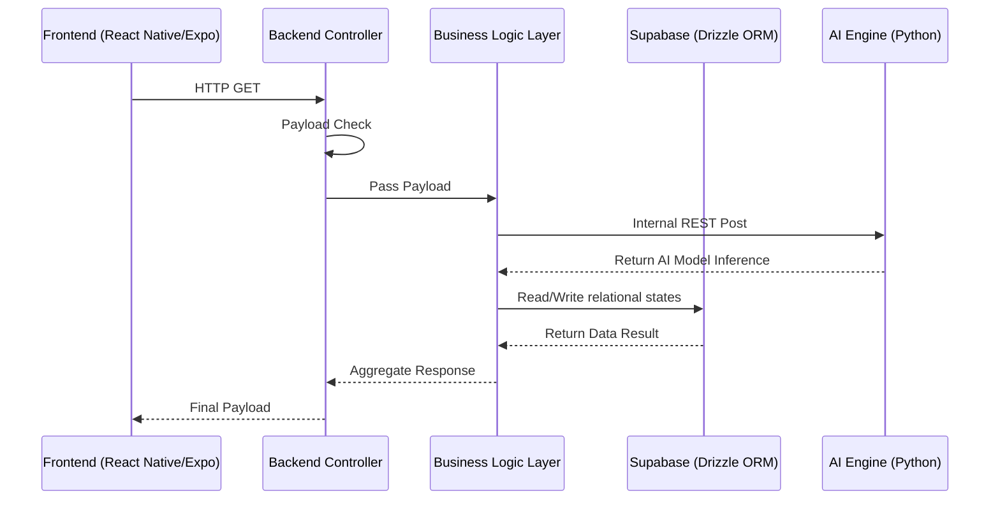

# WearWise System Architecture (ARCHITECTURE.md)

This document provides a high-level overview of the WearWise application architecture, depicting the distinct modules, their communication channels, deployment configuration, and absolute directory structures.

## System Topology Diagrams

### 1. Request Lifecycle Sequence


*(Note: Advanced Authentication flows and Core Business extraction flows are currently pending implementation. See `TODO.md`)*

## Module Contracts

### Backend ↔ AI Engine Pipeline
The Node Backend talks to the Python AI Engine not natively, but over isolated network boundaries via Synchronous REST payloads.

*(Note: Resiliency layers involving exponential backoff and safe AI fallback handling are currently in the roadmap. See `TODO.md` for specs)*

## Directory Structure Map

Maintaining structural discipline throughout the monorepo is mandatory. The project uses a flat organizational structure natively optimized for the Node/Expo runtime context.

```text
/frontend
  /app           -> Expo Router filesystem-based routing configurations
  /assets        -> Static images, fonts, icons
  /components    -> Reusable React Native UI components (buttons, cards)
  /config        -> App layout and env variables configurations
  /constants     -> Static immutable variables
  /hooks         -> Custom React hooks dealing with component state
  /store         -> Zustand configuration and store actions
  /public        -> Static files served as-is by the web build
  /scripts       -> Setup and manipulation CLI wrappers

/backend
  /config        -> Centralized config files (Supabase, CORS, rate limits)
  /controllers   -> Request handlers mapping inputs to business outputs
  /database      -> Seed scripts
  /docs          -> Backend-specific detailed documentations
  /drizzle       -> Drizzle table definitions, schemas and SQL migrations
  /middlewares   -> Validation pipelines, auth, logging injectors
  /routes        -> Express.js route declarations
  /services      -> Heavy lifting, orchestrating API and database behaviors
  /validators    -> Request payload schemas
  /utils         -> Shared helpers (logger, response helpers, error codes)
  /types         -> Generated Supabase type definitions
  /tests         -> Test suite

/ai_engine       -> Flat Python module (FastAPI)
  service.py     -> FastAPI app and HTTP endpoints
  serve.py       -> Uvicorn entrypoint
  classifier.py, hybrid_classifier.py, binary_clothing_model.py -> CLIP + binary classifier models
  /artifacts     -> Trained model checkpoints (Git LFS)
  /utils         -> Logger
```

## Infrastructure and Deployment Topology

A production-ready environment scales modules into specific cloud boundaries. While underlying servers may vary, the architecture generally mimics this topology. 

**Scaling Boundaries:** The Web API Backend and the Python AI Engine are strictly **stateless**. Therefore they MUST be scaled independently since the AI Engine is compute-heavy and the API is network-heavy.
- **Frontend App:** Built natively via EAS (Expo Application Services) or deployed as standalone React Native bundles for specific platforms.
- **Node.js Backend:** Rendered on scalable container orchestration (e.g., Render / AWS ECS / Railway).
- **Postgres Database:** Native to Supabase servers.
- **AI Engine:** Dedicated container on Render / Cloud Run nodes.

---
*For development-specific automation scripts, see `DEVELOPER_GUIDE.md`.*
*For specific AI workflow constraints, please refer to `CLAUDE.md`. For technical logic implementation and Git processes, please refer to `CODING_STANDARDS.md`.*
