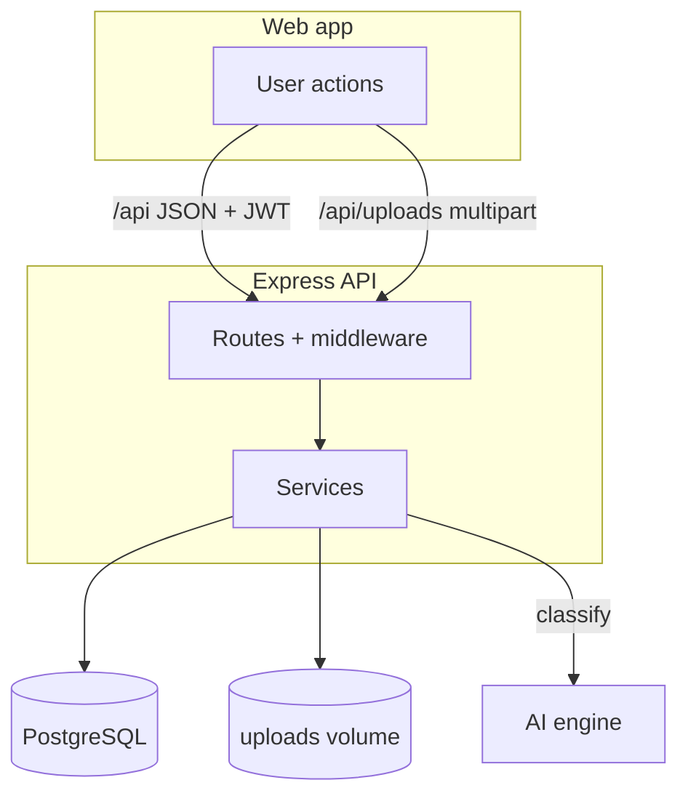

# Data Flow (DATA_FLOW)

How data moves through the WearWise backend: the database, authentication, images and the main business flows.

## 1. Database (PostgreSQL + Drizzle)
- **Connection**: `drizzle/db.js` exports `db` (pool, `DATABASE_URL`). SSL is opt-in with `DB_SSL=require`, because the database normally sits on the internal Docker network.
- **Schema**: `drizzle/schema.ts` is the migration source; `drizzle/schema.js` mirrors it for runtime `require()`. `ai_embedding` is left out of the runtime schema so queries don't return 512-float vectors.
- **Tables**: `users`, `user_credentials` (password hashes, 1:1 with users), `clothes`, `clothing_images`, `notifications`, `ratings`, `follows` (unique follower/followed pair).
- **Migrations**: `drizzle/migrations/` (`0000_extensions` → pgvector, `0001_baseline` → tables, `0002_triggers_and_vector_search` → `updated_at` triggers, HNSW index, `get_similar_clothes()`), applied by `drizzle/migrate.js` on every start.
- **IDs**: `users.auth_uid` equals `users.id` for every account. Services look users up by `auth_uid`, the value carried in the JWT `sub` claim.

## 2. Request handling
Example: *a user edits their profile*
1. `routes/userRoutes.js`: `PATCH /user/:uid` runs `verifyToken` (sets `req.user`) and `validate(updateProfileSchema)`.
2. `controllers/userController.js`: rejects with 403 unless `req.user.uid === :uid`, then calls the service.
3. `services/userService.js`: checks phone uniqueness, then `db.update(users)…returning()`.
4. The controller returns the updated profile as JSON. Errors are thrown as `AppError(message, status)` and formatted by `middlewares/errorHandler.js`.

## 3. Authentication
1. **Register** (`POST /auth/register`): email is normalised to lowercase; email and phone must be unique. The `users` and `user_credentials` rows are inserted in one transaction, the password is hashed with bcrypt (cost 12), and a JWT is returned.
2. **Login** (`POST /auth/login`): `identifier` is an email or a phone number. Unknown accounts still run a bcrypt comparison, so response time doesn't reveal whether an account exists. Wrong email and wrong password give the same 401.
3. **Requests**: the client sends `Authorization: Bearer <jwt>`; `verifyToken` checks the signature and expiry (HS256, `JWT_SECRET`, 7 days). `optionalToken` lets anonymous requests through but rejects invalid tokens.
4. **Logout** is client-side (the token is discarded). Tokens stay valid until they expire.

## 4. Images
1. The client uploads each photo to `POST /uploads` (multipart `image`, ≤ 5 MB).
2. `services/storageService.js` checks the type from the file's magic bytes (JPEG/PNG/WebP), stores it under a random UUID name in `UPLOAD_DIR` (the `uploads` volume) and returns `PUBLIC_API_URL/uploads/<file>`.
3. The client sends those URLs when creating a listing; the backend stores only the URL in `clothing_images`.
4. `GET /uploads/<file>` serves the file with a 30-day immutable cache and `Cross-Origin-Resource-Policy: cross-origin`.

## 5. AI analysis
`POST /ai/analyze` → type check → `services/aiService.js` forwards the image to `http://ai-engine:7860/classify/file` → returns `{ is_clothing, label, top_predictions, ai_suggestions: { name, category, description, is_safe } }`. The frontend uses it to validate photos and pre-fill the listing form.

## 6. Checkout and ratings
1. **Checkout** (`POST /checkout`), in one transaction for each item:
   - claim it with `UPDATE clothes SET status='sold', buyer_id=… WHERE id=… AND status='active' AND user_id<>buyer`
   - if no row was claimed, the whole order is rolled back with 404, 400 or 409
   - otherwise notify the seller (`sale_notification`), send the buyer a `rating_request` (status `pending`), and increment the seller's `sales_count`
2. **Rating** (`POST /ratings`): the buyer sends `notificationId`. The service claims that pending request with a conditional update (owner, type and status must match), then inserts the rating with the seller and item taken from the request, notifies the seller and recalculates their average.

## 7. Data tools
- `database/seeds/seed.js` (`npm run seed`): demo account plus listings from `database/seeds/wardrobe/`, with images stored through the same storage service as real uploads.
- Put future data scripts in `database/` so the backend root stays clean.
