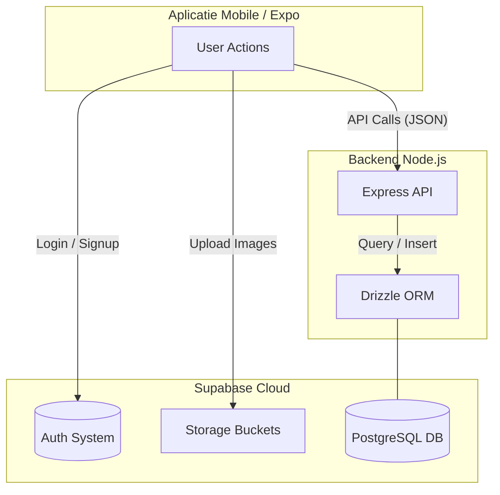

# Arhitectura Datelor și Fluxul DB (DATA_FLOW)

Acest document sumarizează cum interacționăm cu datele în aplicația WearWise. Modulul de Backend Node.js are responsabilitatea de a orchestra fluxurile, apelurile DB și stocarea fișierelor statice.

## 1. Conexiunea la Sistemul SQL (Supabase & Drizzle)
Folosim **Drizzle ORM** pentru a comunica cu instanța Postgres de pe Supabase. Drizzle este type-safe și menține logica la distanță de "raw queries", oferind un standard stabil.

- **Configurația principală**: `backend/drizzle/db.js` – de aici importăm instanța `db` globală în oricare serviciu.
- **Schemele Tabelelor**: `backend/drizzle/schema.js` – Oricând avem nevoie de un tabel nou (ex. Posts, Users, Logs), îl vom descrie prima filă aici și îi vom declara tipurile și relațiile.

## 2. Preluarea și Salvarea Datelor (Cine ce face)
Avem un tipar de MVC extins. Logica "grea" stă în `services`, iar rutele se ocupă strict de parsarea apelului HTTP.

**Exemplu Flux: "Adu informațiile pentru Profilul WearWise"**
1. **Ruta (`routes/userRoutes.js`)**: Primește GET pe `/api/users/profile`. Verifică JWT-ul utilizatorului (auth middleware).
2. **Controller (`controllers/userController.js`)**: Prelucrează request-ul; "User X vrea profilul său". Apeleză Service-ul.
3. **Service (`services/userService.js`)**: Face interogarea la baza de date via Drizzle: `await db.select().from(users).where(eq(users.id, userId))`.
4. Returnează prelucrarea la Controller, care împachetează JSON-ul cu `res.status(200)`.

## 3. Gestionarea Fișierelor Media (Storage) - Flux Direct
Imaginile sunt gestionate printr-un **flux direct (Client-to-Cloud)** pentru a reduce încărcarea backend-ului:

1. **Upload**: Frontend-ul ([useClothes.ts](file:///d:/Workshop/WearWiseApp/frontend/hooks/useClothes.ts)) urcă imaginea direct în bucket-ul Supabase Storage.
2. **URL**: Supabase întoarce un `Public URL` (ex. `https://supabase.com/.../image.jpg`).
3. **Link**: Frontend-ul trimite acest URL către **Backend** prin cererea de creare produs.
4. **DB**: Backend-ul salvează doar *link-ul textual* în baza de date PostgreSQL.

## 4. Autentificarea - Flux Hibrid
1. **Identitate**: Frontend-ul folosește SDK-ul Supabase pentru login/signup (direct cu Supabase).
2. **Profil**: Imediat după login, frontend-ul apelează backend-ul (`/register` sau `/user/:id`) pentru a sincroniza datele user-ului în tabelele noastre din SQL.

## 5. Diagrama de Date (High Level)

## 6. Unelte și Scripturi pentru Date
Am organizat fișierele utilitare în folderul `backend/database/seeds/`:
- `sql_seed.js`: Script principal folosit pentru popularea tabelelor cu un set de date dummy utile pentru dev/testare.
- `setup_storage_policy.js`: Asigură setarea corectă a permisiunilor de citire/scriere (RLS) la Storage Bucket.
- Mutați orice utilitar sau automatizare pe DB de pe viitor în acest folder pentru a păstra folder-ul root al backend-ului curat.
